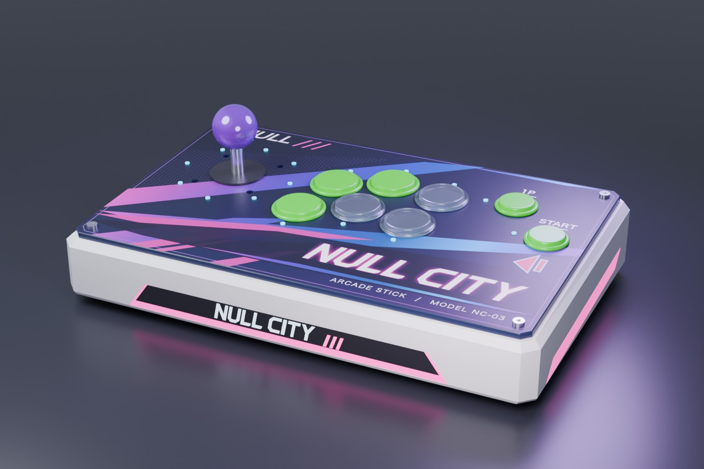
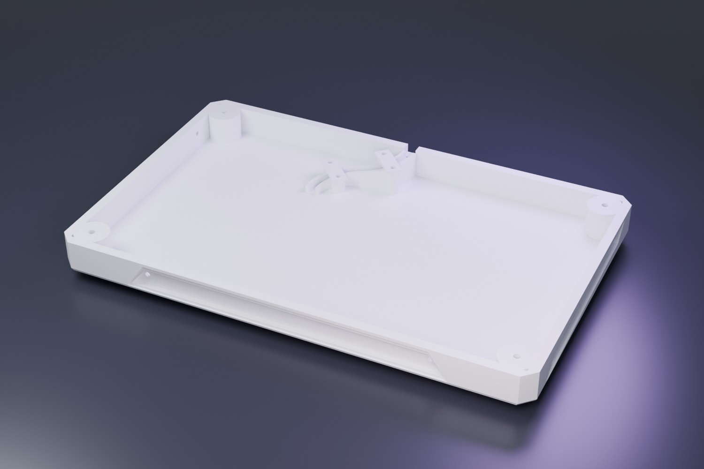

# 参考画像に合わせた前面・左右側面の発光構造



白い面取りケース、奥上がり2.55°の天板、前面の台形発光部、左右側面の上下辺・両端をそれぞれ平行に揃えた斜めの帯を参考画像に合わせて構成した。外形は300 × 190 mm、後端の脚込み高さは約55 mm。**実機で印刷した4 mm天板・40 × 40 mm直接取付は維持**し、旧案の3 mm＋1 mm分割天板やMS金属ベースへ戻していない。

発光はレンダリング上のイメージ。溝・配線穴・乳白カバーは実際の造形データへ含めたが、光量・色・均一性・熱は実物で未検証。

## 造形される部分



- 前面と左右側面の外側へLEDテープを収める浅い溝を加工。6 mm壁の内側に1.4 mmを残す。ケース内部へ大きく開いた穴ではなく、外側の溝に置くLEDを乳白カバーで覆う構造。奥側に受け段を残し、接着材だけに押し込み荷重が掛からない形にした。
- 前面の左右端と、左右側面の前後端にφ3.2 mmの**配線貫通穴を計6個**設け、ケース内部の配線へつなぐ。
- 溝の天井とカバー上辺は厚さ方向に45°。受け段の内側天井も45°を維持し、側面窓は平行四辺形とし、左右はX軸に対する鏡対称にする。サポートなし設定でスライス済みだが、受け段の仕上がりは試験片で確認する。
- 外周のUSB S字ガイドと押さえ2個は維持。光源の配線は内周沿いに通し、レバーやUSB経路を横断させない。

## 乳白カバー

| 位置 | 部品 | 寸法の目安 |
|---|---|---|
| 前面 | [PRINT_light_front_diffuser.stl](STL/PRINT_light_front_diffuser.stl) | 外接203 × 16 mm、厚さ1.2 mm |
| 左側 | [PRINT_light_left_diffuser.stl](STL/PRINT_light_left_diffuser.stl) | 外接約143 × 約16.3 mm、厚さ1.2 mm |
| 右側 | [PRINT_light_right_diffuser.stl](STL/PRINT_light_right_diffuser.stl) | 同上。左右は鏡対称 |

乳白・半透明PLAを使用する。前面は下辺・上辺・斜辺、左右は上下辺・両端にケースと一体の受け段を設けた。カバー裏面は前面Y=−93.8 mm、側面X=±148.8 mmで受け止め、外側から薄手の両面テープで脱落を防ぐ。嵌合爪・ねじは設けていない。厚さ0.1 mm以下の貼付材を想定し、発光する面や配線穴を塞がない。レンズ外形は変更せず、下辺・両端に0.25〜0.5 mm程度の設計隙間を確保した。前面の受け幅は下辺1 mm、側面は下辺1 mm・上辺0.5 mm（中央断面）。LED前面からレンズ裏面までの隙間は前面1.5 mm、側面0.6 mm。側面は受け段と幅5 mmテープが干渉しないよう光源を溝の外側へ寄せた。

前面の[黒マスクSVG](artwork/decal/NC03_front_mask.svg)／[実寸PDF](artwork/decal/NC03_front_mask.pdf)を乳白カバーの中央に貼り、下辺と斜辺を残す。「NULL CITY」は専用ロゴと同じアウトライン、幅約65.4 mmで配置。文字やマスクの透過・接着は実シートで確認する。印刷倍率は100%、用紙に合わせて縮小しない。

## LEDと配線の前提

[寸法設定](artwork/lighting_layout.json)は、裸基板の**幅5 mm以下・厚さ1.8 mm以下**の細幅5 Vテープ用。収容長は前面180 mm、左右各120 mm以内。コネクタや大きなはんだ盛りは溝の外へ逃がす。普通の8／10 mm幅テープはこの版には入らない。

候補の[Adafruit Mini Skinny NeoPixel 60 LED/m](https://www.adafruit.com/product/2963)は、メーカー記載で保護カバー付きが幅7.5 × 厚さ4 mm、カバーなし基板が幅5 mm。**保護カバー付きのままでは収まらない。** 裸基板の実厚・端子とはんだ部分を照合する。60 LED/mなら前面10画素と左右各7画素の計24画素が収容長の目安内に入る。実際の切断位置に合わせる。

照明用の5 V電源、RGBテープ用コントローラー、配線、点灯ファームウェアは未選定・未実装。ゲーム入力用USB基板からの給電兼用は前提にしない。操作部周辺の表示LED16個とは別系統で、まずマゼンタ固定色を想定する。採用品の定格と最大設定輝度から電流・電源・温度を確認する。

## 印刷用データ

- 下ケースだけ：[時短3MF](print/h3c/01_lower_tray_fast.3mf)（下ケース＋USB押さえ2個）。カバーは含まない。
- カバーだけ：[乳白カバー3個の3MF](print/h3c/06_light_diffusers.3mf)。0.20 mm積層、100%直線充填、サポートなし。
- 一式：[6プレート版](print/h3c/NC03_H3C_6plates_lighting_sliced.3mf)。プレート1=下ケース＋USB押さえ、2=上フレーム、3=天板、4=任意キャップ、5=TPU脚、6=乳白カバー。材料は本体PLA・脚TPU・カバー用半透明PLAを別割当。

実ボタンを使う場合はプレート4を省略できる。印刷済みの天板を再印刷する必要はない。USBガイドは[小型試験片](print/usb-relief/README.md)でも確認できる。受け段は[前面・側面40 mm幅の試験片](print/lighting-fit/README.md)で先に嵌合と押し込みを確認する。

## 検証と残る確認

Blender 5.3で20個の印刷メッシュが水密、天板33穴の貫通、レバー取付穴・最小壁厚4.2 mmを確認。3枚のカバーは外側へ0.02 mm離せば非干渉、内側へ0.1 mm押せば受け段と交差することを検証。想定LEDテープとケースの非干渉、6個の配線貫通穴、溝裏1.4 mm壁を確認し、USBガイドのケーブル／レバー／ボタン包絡の検証も再実行した。

光源・カバーの実物嵌合、接着、光学・温度、配線込みのケース全体の仮組みは未実施。Issue #5と、受け段の実物押し込み確認を必要とするIssue #11は継続。ユーザーの待機指示により印刷送信は再開していない。

```sh
blender --background --factory-startup --python-exit-code 1 --python NULL_CITY_NC03.py
blender --background NULL_CITY_NC03.blend --python-exit-code 1 --python scripts/validate_lighting.py
blender --background NULL_CITY_NC03.blend --python-exit-code 1 --python scripts/render_lighting.py
python3 scripts/export_front_mask.py
python3 print/h3c/slice_plates.py
python3 print/h3c/slice_body_fast.py
python3 print/h3c/combine_plates.py
```

## 設定と再生成

`artwork/lighting_layout.json` は編集する入力ファイル。モデルの生成で上書きしない。前面・側面の溝、受け段、レンズ、光源位置、マスク外形・用紙寸法・ロゴ位置をここから読む。`NULL_CITY_NC03.py` の出力先はスクリプトのあるリポジトリに固定し、作業ディレクトリや既に開いたblendに依存しない。

`python3 scripts/export_front_mask.py` でSVGと実寸203 × 17 mmのPDFを再生成する（PDF出力にはGoogle Chromeが必要）。`python3 scripts/render_all.py` でREADMEの完成予想図、分解図、三面図、ワイヤーフレーム、USB詳細をBlenderから一括再生成する。フォント字形の正本は `fonts/null-font/brand-glyphs.json`。`scripts/update_wordmark.py` とフォント生成が共通で読み込む。

## ケース高さと配線経路

現在は下ケース24 mm、上フレーム分割面Z=24〜43 mm、天板4 mmという構成を維持する。レバーはMS板を使わず、実測した天板裏面下28.1 mmの直接取付とする。前後95 mmの包絡に配線5 mm・誤差1 mmを加えても、計算上の床余裕は2.620 mm。従来のMS板込み寸法に基づく高さ増加は採用しない。

照明線は6個の配線穴からケース内周沿いへ引き込む。レバーの70.5 × 95 mm包絡の直下、ボタン端子、USB S字経路を横切らせない。配線留め・コネクタ・実ハーネスは未実装であり、接続済み部品の全体仮組み（Issue #5）で実経路を確認する。仮組みで高さを変更する場合は照明寸法も再検証する。

## 側面の輪郭

側面の帯は平行四辺形。上下辺は天板の2.55°傾斜に平行、前後の斜辺も互いに平行とし、左右はX=0の面に対して鏡対称にした。外接幅約143 mm、外接高さ約16.3 mm、厚さ1.2 mm。LED収容長は左右各120 mmへ更新し、配線穴はY=±58 mmへ移動。受け段と厚さ方向45°の天井は維持する。

完成予想図と分解図は70 mmレンズの透視投影を使用する。三面図・ワイヤーフレーム・USB経路詳細は形状確認用の平行投影。カメラの違いで輪郭を判断しにくくならないよう、三面図では側面の平行関係を数値と合わせて確認できる。
