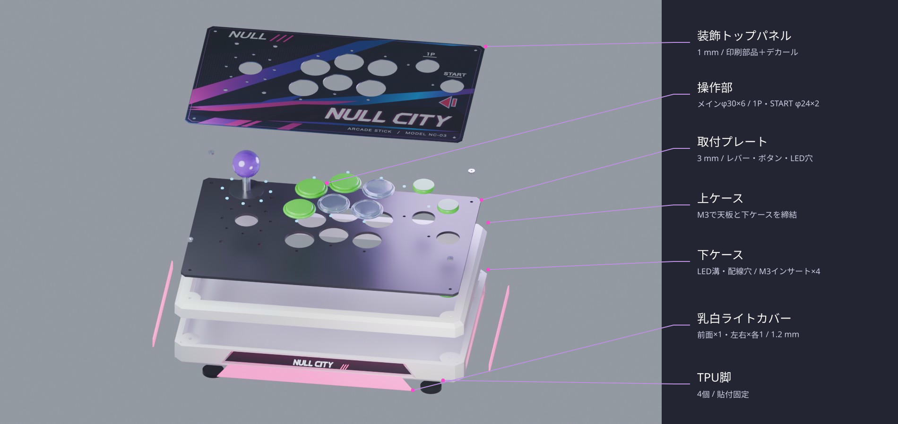
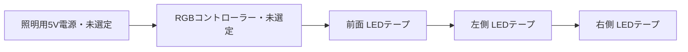

# 前面・側面照明と分解構成

参考画像に合わせ、前面と左右側面をマゼンタで照らす構成。LEDテープを下ケースの浅い溝に貼り、別体の乳白カバーで拡散する。モデルの発光は点灯イメージで、実物の光量・均一性・温度は未検証。

## 上からの積層

| 部品 | 厚さ・数量 | 役割 |
|---|---|---|
| 装飾トップパネル | 1 mm・1枚 | デカールを貼る交換部品。操作部の穴は取付プレートと同位置 |
| 操作部 | 主φ30×6、補助φ24×2、LS-55-01×1 | レバーはMSベースを90°回して装着 |
| 黒い取付プレート | 3 mm・1枚 | 操作部を支持。トップパネルと重ねた締付厚は4 mm |
| 上ケース | 1個 | 天板を支持し、下ケースと四隅で締結 |
| 下ケース | 1個 | LED溝、配線穴、USB切り欠き、M3インサート下穴 |
| 乳白ライトカバー | 前面1＋左右各1 | 前面は黒マスクで下辺・斜辺だけを見せる |
| TPU脚 | 4個 | 接着材等で貼付固定 |

トップパネルと取付プレートは、操作部の締付リングと四隅のM3ねじでまとめて固定する。トップパネルだけを変更する場合も、レバー・ボタンを一度外す。M3インサートは下ケース側、レバーは3 mmスペーサーを介して取付プレート裏に固定する。

## LED溝とカバー

- 前面カバーは約203 × 16 × 1.2 mm。左右カバーは各約143.4 × 16.34 × 1.2 mmの外接寸法で、帯が天板と同じ2.55°で上がる。
- 下ケースの壁厚6 mmに対し、LED溝は深さ4.6 mm。奥に1.4 mmの壁を残す。天井は外へ上がる45°、乳白カバーの上辺も対応する傾斜にした。
- テープの収容上限は幅5 mm・厚さ2 mm、長さは前面180 mm・左右各130 mm。コネクターや大きなはんだ盛りは溝に収めず、φ3.2 mm配線穴を通して内側へ出す。
- カバーは外側から取り付け、外周の薄手両面テープで保持する。嵌合爪・ねじ固定はない。厚さ0.1 mm以下の貼付材を想定し、発光面を塞がない。
- 前面の黒マスクは[実寸PDF](artwork/decal/NC03_front_mask.pdf)／[SVG](artwork/decal/NC03_front_mask.svg)。黒シートに白文字を印刷するか、白文字シートを重ねる。乳白カバーを全面黒く覆わず、下辺・斜辺を残す。

## テープと配線の選定

候補は[Mini Skinny NeoPixel 60 LED/m](https://www.adafruit.com/product/2963)などの細幅5Vテープ。メーカー仕様では保護カバー付きが幅7.5 mm・厚さ4 mmで、そのままでは入らない。裸基板は幅5 mmだが、実際の厚みと接続部を照合する。テープは指定の切断位置だけで切る。

60 LED/mの場合、前面10画素（約167 mm）＋左右各7画素（各約117 mm）の計24画素が収容長内に入る。当面の色はマゼンタ固定を想定。RGBのコントローラー、電源定格、配線、ファームウェアは未選定・未実装で、USBゲーム入力基板からの給電兼用は前提にしていない。16個の操作表示LEDとは別の回路になる。

図は構成の概念で、端子間の結線図ではない。電源・GND・信号方式を採用品に合わせ、LEDの電流と温度を確認する。レバー下の空間は狭いため、照明配線はケース内周へ沿わせ、レバーや端子の下を横切らせない。

## 造形と確認

標準プロジェクトは機能部品11点を6プレートに分割。外観キャップ8点は任意の別プロジェクトで、標準プロジェクトには含めない。STLライブラリーは計19点。プレート4はトップパネル1点。乳白カバー3個はプレート6で、PLA用の温度設定を実際の乳白・半透明材料へ合わせて交換する。

LED溝・カバーの嵌合、レバーの向きと可動域、LED足、ねじ長さ、テープの温度を仮組みで確認する。レンダリングの発光材質は印刷したPLA自体の発光を表していない。
