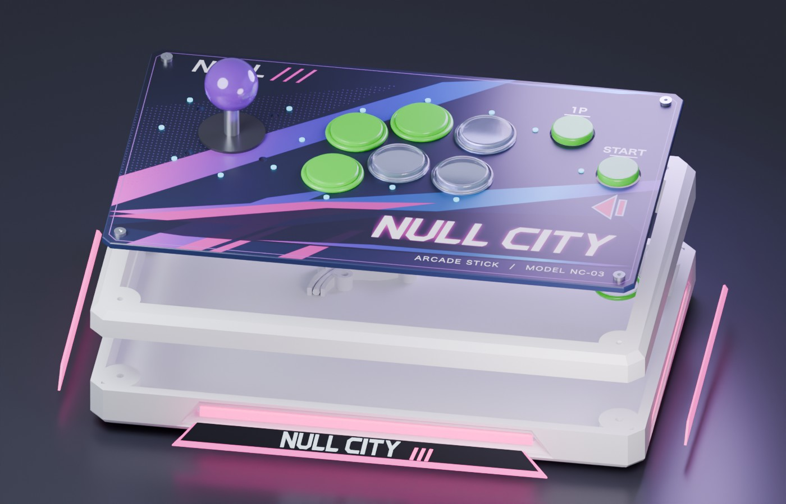

# NULL CITY NC-03

Bambu H3C向けの、交換式天板を備えたアーケードスティック筐体の試作。外観資料の白い面取りケース、ネイビーの斜線グラフィック、紫のレバー、緑3個・透明3個の操作部、横並びの1P／STARTを3Dで再構成した。


## 三面図

上面・正面・右側面を同一縮尺の第三角法で配置。右側面図で、奥に向かって天板が2.55°上がる形状を確認できる。


## ワイヤーフレームと分解図

天板・上フレーム・下ケースのメッシュ辺を表示。操作部の開口と、四隅の締結部の位置関係を示す。




## 寸法と部品

| 部位 | モデル上の寸法・仕様 |
|---|---|
| 下ケース | 300 × 190 × 24 mm。前面に黒い窓とマゼンタのライトガイドを配置する凹部 |
| 上フレーム | 水平な下面に対して天板側を奥上がり2.55°にした八角形。下ケースと合わせて公称300 × 190 mm |
| 天板 | 288 × 178 × 4 mm。筐体高は後端で約51 mm、TPU脚を含めて約55 mm（レバー・ボタン・ねじ頭を除く） |
| 操作部 | メイン穴6個 φ30.4、右側2個 φ12.4、レバー穴 φ24 mm。実スイッチを取り付ける場合はメーカーの推奨天板厚を確認 |
| 四隅の取付 | M3クリアランス φ3.4 mm。下ケースの熱圧入インサート下穴は φ4.1 × 6 mm。実部品に合わせて試験片で調整 |

## ファイルと再生成

- `NULL_CITY_NC03.blend` は印刷用部品・外観部品・撮影セットを収めた組立モデル。天板画像は内蔵。
- `NULL_CITY_NC03.py` はBlender 4.3.2で動作確認した生成スクリプト。STLは各部品を印刷向きに戻して底をZ=0に揃える。
- `STL/` に上下ケース、天板、外観用キャップ8点、脚4点の計15ファイルを収録。
- `artwork/decal/NC03_decal_print.pdf` は288 × 178 mm実寸デカール。印刷は倍率100%・実際のサイズを選び、用紙に合わせて縮小しない。A4には収まらないためA3以上を使用する。`NC03_decal_cut_guide.pdf` は外周・操作穴・M3穴のカットガイド入り。固定穴未追加のレバー仕様は確定後に再出力する。
- `artwork/panel.svg` は編集可能な天板の印刷原稿。`panel.png` はBlenderが読む画像。UV印刷・デカール用の図柄として扱う。
- `PRINT_SETTINGS.md` に造形設定を記載。`print/h3c/NC03_H3C_5plates_fast_sliced.3mf` はH3C／0.4 mm向けの5プレート版（PLA、脚のみTPUの仮設定）。
- 1Pボタンは初版から奥へ33 mm移動。STARTは元の位置。レバー固定穴は型番・取付寸法の確認待ちで未追加。
- USBケーブルは背面中央の幅8 × 深さ6 mmの切り欠きへ、上下ケースの組立時に通す。実ケーブル径と曲げ半径を確認する。

リポジトリ直下で実行する。

```sh
blender -b --factory-startup --python-exit-code 1 -P NULL_CITY_NC03.py
blender -b NULL_CITY_NC03.blend --python-expr "import bpy; bpy.ops.render.render(write_still=True)"
```

## 試作の範囲

窓、発光表現、レバー、ボタン縁、ねじ頭は外観用。実発光させる場合の配線と基板、レバー固有の取付穴は未設計。USBケーブル出口は背面中央の合わせ面に幅8 × 深さ6 mmの切り欠きを設けた（コネクター固定・抜け止めは未設計）。上フレームの厚さは前後で異なるため、M3ねじの長さは各位置の積層厚とインサートの有効深さに合わせる。実機印刷・組立は未検証。
