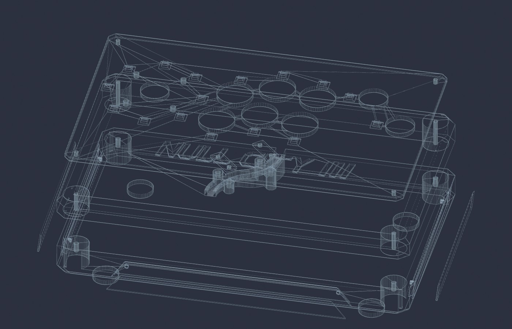

# NULL CITY NC-03

Bambu H3C向けの、交換式天板を備えた**汎用6ボタンのアーケードスティック**。VF2専用機ではない。外観資料の白い面取りケース、ネイビーの斜線グラフィック、紫のレバー、緑3個・透明3個の操作部、奥へ移動した1Pと右側のSTARTを3Dで再構成した。

## 印刷前のレバー確認

Issue #4・#5は実物確認待ちです。[等倍取付テンプレート・積層表・底面クリアランス計算](docs/fit/README.md)で照合してください。写真ではMSなしの直接取付に見えるため、[40 mm角の取付試験片（H3C用・約26分）](docs/fit/PHOTO_REVIEW.md)を先に確認してください。図面寸法の誤読を訂正すると、現行MS前提の形状は底面に干渉する計算です。製品用天板・ケースの本印刷は保留してください。

## 確定仕様

[Issue #2の決定](https://github.com/GOROman/null-city/issues/2#issuecomment-6889331965)によりB案「汎用6ボタン」を採用。緑3個と透明3個のメインボタンは、すべて実スイッチとして配線する。クリアプラグやダミーで塞ぐ穴はない。

| 項目 | 確定した数量・役割 |
|---|---|
| レバー | 1本。方向入力は上下左右の4入力 |
| メインボタン | φ30を6個：緑3個＋透明3個。6個すべて機能する |
| 補助ボタン | φ24を2個：1P／START |
| USB基板の最低入力数 | 方向4＋メイン6＋補助2＝12入力以上 |
| 操作表示LED | レバー8方向＋メイン6＋補助2＝16個。8方向表示とレバーの入力4本は別の数え方 |
| 天板の表記 | 1P／STARTを維持。G／P／Kなどゲーム固有のレジェンドは付けない |

ボタンのゲーム内割当は使用するゲームに合わせる。制御基板の型番、LED駆動・配線・点灯制御は未選定・未実装。上記は機能仕様と必要数の確定で、実機の動作検証ではない。


部品表：[BOM.md](BOM.md) ／ [BOM.csv](BOM.csv)。メインφ30を6個、補助の1P／STARTはφ24を2個。

## 三面図

上面・正面・右側面を同一縮尺の第三角法で配置。右側面図で、奥に向かって天板が2.55°上がる形状を確認できる。


## ワイヤーフレームと分解図

天板・上フレーム・下ケースのメッシュ辺を表示。操作部とLEDの開口、四隅の締結部、背面のUSBケーブル切り欠きの位置関係を示す。




## 寸法と部品

| 部位 | モデル上の寸法・仕様 |
|---|---|
| 下ケース | 300 × 190 × 24 mm。前面に黒い窓とマゼンタのライトガイドを配置する凹部（天井は手前上がり45°でサポート不要） |
| 上フレーム | 水平な下面に対して天板側を奥上がり2.55°にした八角形。下ケースと合わせて公称300 × 190 mm |
| 天板 | 288 × 178 × 4 mm。筐体高は後端で約51 mm、TPU脚を含めて約55 mm（レバー・ボタン・ねじ頭を除く） |
| 操作部 | メイン穴6個 φ30.4、補助2個 φ24.4（φ24ボタン用）、レバー穴 φ24 mm。主操作部はBlast City 1Pの6ボタン配列。実スイッチを取り付ける場合はメーカーの推奨天板厚を確認 |
| レバー固定 | セイミツLS-55-01／MSベース想定。MSプレートを90°回し、長辺を前後方向にして装着。40 × 85 mmピッチ（左右 × 前後）、M4用φ4.5 mmの4穴。裏側は3 mmスペーサーを介して装着 |
| LED穴 | レバー周囲8方向＋メインボタン6個＋1P／START各1個の計16穴。3 mm丸型LED想定のφ3.2 mm仮寸法。レバー周囲は半径25 mm |
| 四隅の取付 | M3クリアランス φ3.4 mm。下ケースの熱圧入インサート下穴は φ4.1 × 7.5 mm（6 mmインサート＋樹脂の逃げ1.5 mm）。実部品に合わせて試験片で調整 |

## Bambu Studio の設定

Bambu Studio 02.09.01.70のH3C公式プロファイルを使用。機種は **Bambu Lab H3C / 0.4 mm / Standard**、プレートは **Textured PEI Plate**。実際のノズル・装着プレート・材料銘柄が異なる場合は一致させて再スライスする。

| 項目 | 同梱5プレート版：時短試作 | 個別の本体3ジョブ：標準試作 |
|---|---|---|
| 積層 / 初層 | 0.28 / 0.20 mm | 0.20 / 0.20 mm |
| 壁 | 3周 | 4周 |
| 上面 / 底面 | 各4層 | 各5層 |
| 充填 | Gyroid 10% | Gyroid 15% |
| 本体のブリム | 外周5 mm / 隙間0.15 mm | 同左 |
| サポート | なし | なし |
| 初層外周 / 初層充填 | 30 / 50 mm/s | 同左 |
| 外壁 / 天面 | 100 / 80 mm/s | 同左 |
| 内壁・充填・移動 | H3C公式値を使用。材料の最大体積流量を優先 | 同左 |

材料の開始値は **Generic PLA：ノズル220℃ / ベッド55℃ / 最大体積流量12 mm³/s**。本体のPLAは反り対策として補助・オプション冷却ファン0%、パーツ冷却は材料プロファイルの自動設定を使用する。材料メーカーの温度指定が異なる場合はそちらを優先する。

キャップは壁3周・ブリムなし。TPU脚は別プレートで **0.20 mm・壁3周・充填20%・ブリムなし**。同梱Generic TPUの仮設定はノズル230℃ / ベッド35℃ / 最大体積流量3.2 mm³/s。硬度・銘柄・給材経路に合うTPUプロファイルへ変更してから出力する。

[5プレート3MF](print/h3c/NC03_H3C_5plates_fast_sliced.3mf)をプロジェクトとして開き、印刷順序はレイヤーごと。STLを部品ごとに再読込する場合は印刷面を下にしてベッドへ接地させる。実ボタンを組む場合は外観キャップ専用のプレート4を省略できる。設定の詳細と見積は[PRINT_SETTINGS.md](PRINT_SETTINGS.md)。実機印刷は未検証のため、穴とインサートの試験片で嵌合を確認する。

## ファイルと再生成

- `NULL_CITY_NC03.blend` は印刷用部品・外観部品・撮影セットを収めた組立モデル。天板画像は内蔵。
- `NULL_CITY_NC03.py` はBlender 4.3.2で動作確認した生成スクリプト。STLは各部品を印刷向きに戻して底をZ=0に揃える。
- `STL/` に上下ケース、天板、外観用キャップ8点、脚4点の計15ファイルを収録。
- `artwork/decal/NC03_decal_print.pdf` は288 × 178 mm実寸デカール。印刷は倍率100%・実際のサイズを選び、用紙に合わせて縮小しない。A4には収まらないためA3以上を使用する。`NC03_decal_cut_guide.pdf` は外周・操作穴・M3穴のカットガイド入り（LED16穴も反映）。レバー固定穴4個も反映。
- `artwork/logo/null-city.svg` は専用の角形・右斜体ベクターロゴ。既製フォント不要。`wordmark.json` を前面ロゴにも共用する。天板の表記は「1P」に統一し、「1 PLAY」は削除。
- `artwork/panel.svg` は編集可能な天板の印刷原稿。`panel.png` はBlenderが読む画像。UV印刷・デカール用の図柄として扱う。
- `PRINT_SETTINGS.md` に造形設定を記載。`print/h3c/NC03_H3C_5plates_fast_sliced.3mf` はH3C／0.4 mm向けの5プレート版（PLA、脚のみTPUの仮設定）。
- 1Pボタンは初版から奥へ33 mm移動。STARTは元の位置。レバー固定穴はLS-55-01のMSベース基準で4個（40 × 85 mmピッチ、M4用φ4.5 mm）。プレートを横長（85 × 40）に置くと、角が左下ボタン穴に3.2 mm重なり、右手前のM4穴とボタン穴の壁が1.1 mmになるため、90°回した縦長配置に変更した。この向きでレバーが使えること、方向スイッチ4個の割り当てを配線で入れ替えることを実物で確認する。
- ゲーセンバッグの[公式説明書21ページ](https://drive.google.com/file/d/1D0X1x019IUx4OJuBd43U7_CETa2sEljN/view)でLS-55-01採用を確認。[メーカーMSベース寸法図](https://seimitsu.co.jp/wp-content/uploads/2023/11/%E5%AF%B8%E6%B3%95%E5%9B%B3%E7%94%A8_LS-55-01.pdf)に基づく固定穴を追加。縦長配置のプレート（50 × 95 mm）は上フレームの開口内に収まるため、フレーム裏側の逃げ加工は不要になった。説明書はベース種類を指定していないため、手元のベースがMSか照合する。
- M4の3 mmスペーサー4個を天板と取付プレートの間に入れ、LEDの足はこの隙間で曲げて横へ配線する。ねじ長さはワッシャー・ナットを含む実物の積層厚に合わせる。ケース底との余裕が小さいため、レバー本体・コネクター・LEDの足が接触しないか仮組みで確認する。
- `artwork/control_layout.json` は主操作部の共通座標。Slagcoinの[Sega 1P配列図](https://www.slagcoin.com/joystick/layout.html)と[寸法図](https://www.slagcoin.com/joystick/layout/sega1_m.png)を参照し、Blast City用の高いレバー位置と下段中央の右0.5 mm補正を反映。左上ボタン中心を維持し、レバー中心を右3 mm・奥27 mmへ移動した。左上ボタンはレバー中心から右66 mm・奥10 mm。1P／STARTの位置は維持。
- `scripts/update_wordmark.py` でロゴを生成し、`scripts/export_decals.py` で共通座標から天板テクスチャ・デカールPDF・カットガイドを再生成する。
- `artwork/led_layout.json` にLED座標と仮の穴径を記載。ボタンを照らす光学部品・LED固定具・配線・制御基板は未設計。現モデルは各ボタン付近の独立した表示LEDを想定。
- `scripts/render_readme.py` は現行BlenderモデルからREADME画像を再生成する。
- USBケーブルは背面中央の幅8 × 深さ6 mmの切り欠きへ、上下ケースの組立時に通す。実ケーブル径と曲げ半径を確認する。

リポジトリ直下で実行する。

```sh
blender -b --factory-startup --python-exit-code 1 -P NULL_CITY_NC03.py
blender -b NULL_CITY_NC03.blend -P scripts/render_readme.py
```

## 試作の範囲

窓、発光表現、レバー、ボタン縁、ねじ頭は外観用。実発光させる場合の配線と基板は未設計。USBケーブル出口は背面中央の合わせ面に幅8 × 深さ6 mmの切り欠きを設けた（コネクター固定・抜け止めは未設計）。上フレームの厚さは前後で異なるため、M3ねじの長さは各位置の積層厚とインサートの有効深さに合わせる。実機印刷・組立は未検証。
