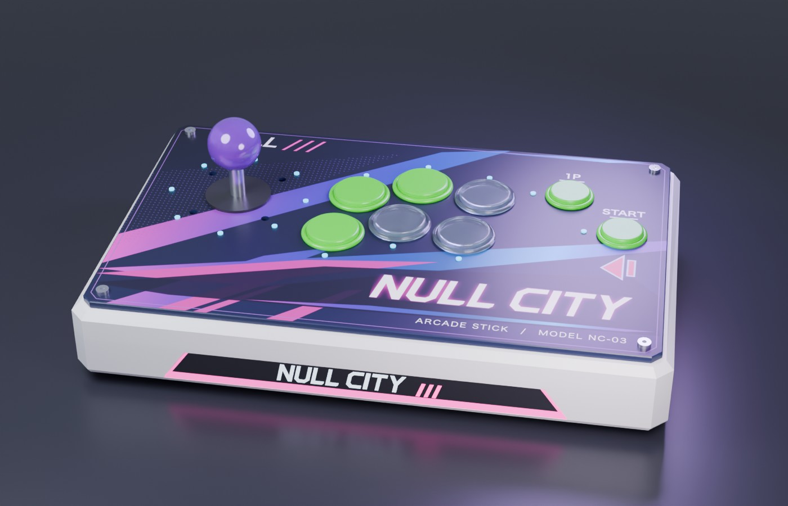
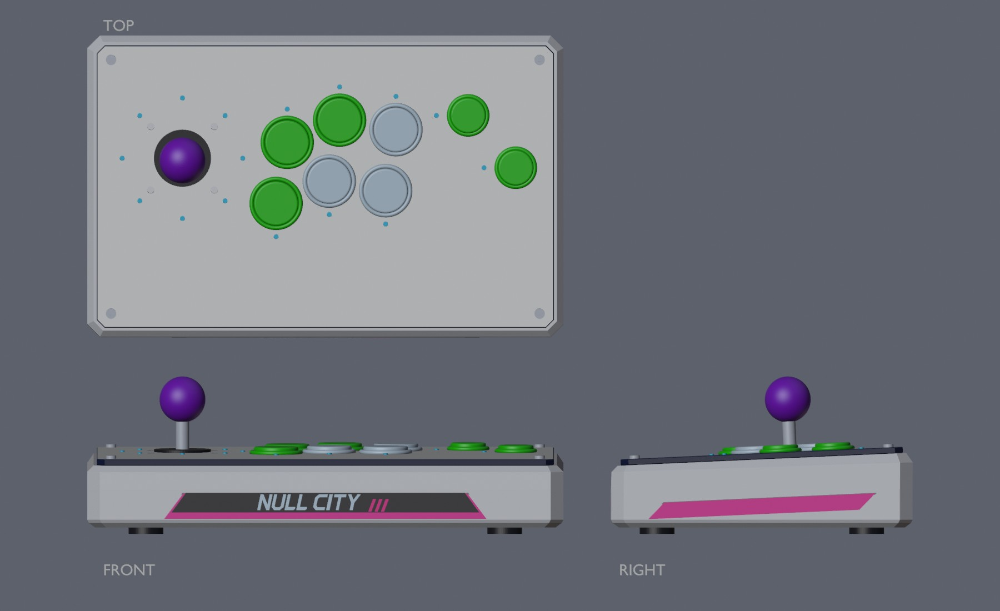
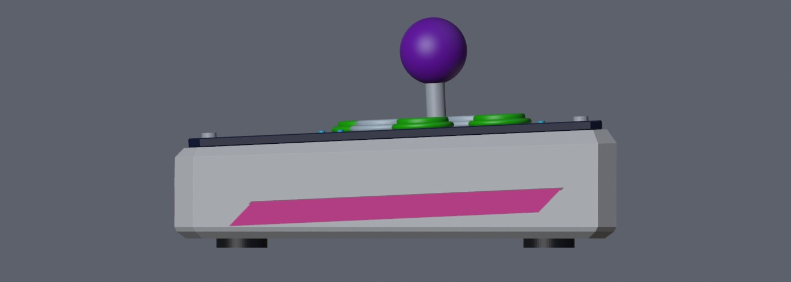
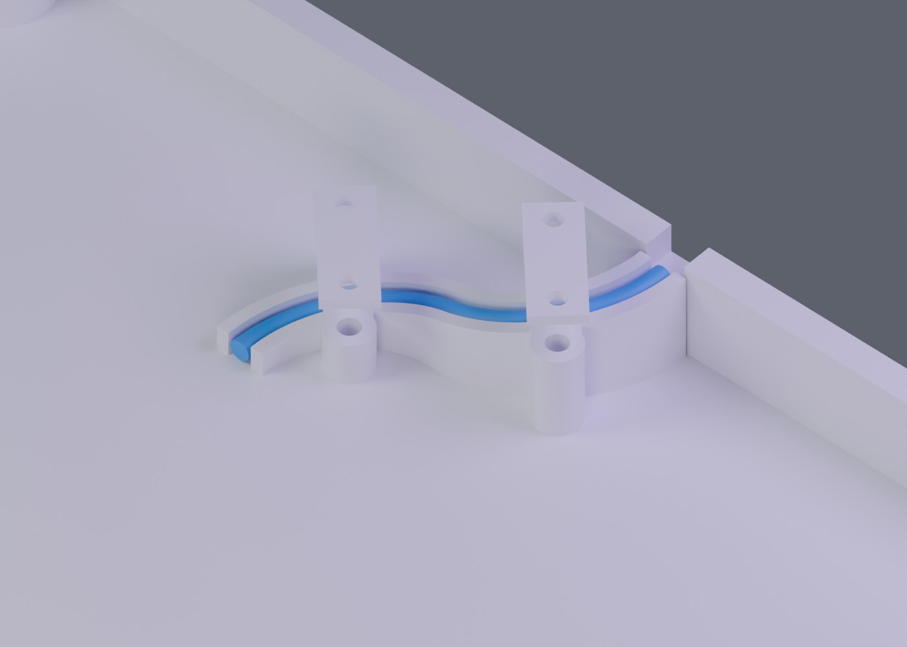

# NULL CITY NC-03

Bambu H3C向けの、交換式天板を備えた**汎用6ボタンのアーケードスティック**。VF2専用機ではない。外観資料の白い面取りケース、ネイビーの斜線グラフィック、紫のレバー、緑3個・透明3個の操作部、奥へ移動した1Pと右側のSTARTを3Dで再構成した。

## 印刷前のレバー確認

40 × 40 mm・厚さ4 mmの試験片でねじ4本の取付と8方向の操作を確認済み。製品用天板もMS板なしの直接取付へ更新しました。[測定・クリアランス](docs/fit/README.md)では本体突出28.1 mm、配線5 mm＋誤差1 mmを仮定した床余裕2.62 mmを確認。接続済み配線・LED・ケース全体の仮組みは未確認（Issue #5）。

## 現在の確認状況

| 項目 | 状況 |
|---|---|
| レバー取付・操作 | 厚さ4 mmの試験片で元ねじ4本の固定と8方向動作を確認済み |
| レバー本体の突出 | 板厚込み32.1 mm − 板厚4 mm = 裏面下28.1 mm。ユーザー実測確認済み |
| 天板の実機印刷 | 青色PLAの完成品をIMG_9794/9797/9798で確認。レバー・主ボタン6個・補助1個の装着写真あり。残り補助1穴は未装着 |
| 製品用データ | 40 × 40 mmの直接取付穴・方向LED半径38 mmをモデル、STL、3MF、デカールと下記画像へ反映済み |
| 底面クリアランス | 前後95 mm包絡・配線突出5 mm・誤差1 mmという仮定で2.620 mm。ケース全体の仮組みは未実施 |
| LED・ボタン・配線 | 実部品の保持・足・締付リング・コネクタとケース内の干渉確認が必要。[Issue #5](https://github.com/GOROman/null-city/issues/5)を継続 |

天板だけを試作する場合は[単独の天板3MF](print/h3c/03_control_panel.3mf)を使用。積層0.20 mm・壁4周・上下面5層・Gyroid 15%・外周ブリム5 mm・サポートなしを保存し、GUI読み込み時の設定保持情報も付与。再スライス後に値を確認する。ケースや脚を同時に印刷する必要はない。レバー以外の穴とデカールも、この天板で実物を合わせて確認する。

### 天板の時短試作

[天板だけの時短3MF](print/h3c/03_control_panel_fast.3mf)はCLI見積 **2時間55分55秒・103.54 g**。積層0.28 mm、壁3周、上下面3層、Gyroid 5%、天面100 mm/s。サポートなし、外周ブリム5 mm。厚さ4 mm・穴位置・C0.5面取りは標準版と同じ。標準版より剛性・表面品質が下がる可能性があるため試作用とする。実機の準備や補正によって3時間を超える場合もある。GUIで設定を確認して再スライスする。

## 前面・左右側面の発光構造

参考画像の白い面取りケース・前面の台形輪郭・斜めの側面発光帯を、[造形データと照明構成](LIGHTING.md)へ反映。印刷済みの4 mm天板とUSB S字ガイドを維持し、下ケースにLED収容溝と配線貫通穴6個、別体の乳白カバー3枚と押し込みを止める受け段を追加しました。側面の発光帯は、上下辺と両端をそれぞれ平行にした平行四辺形です。受け段は[小型試験片](print/lighting-fit/README.md)で実物確認待ちです。


光学・温度と点灯回路は未検証。現モデルは**裸基板幅5 mm・厚さ1.8 mm以下の細幅5 Vテープ用**で、普通の8／10 mm幅や保護カバー付きテープは収まりません。カバーは半透明PLAで別プレート6へ配置。発光自体は完成予想のレンダリングです。

下ケースを印刷する場合は[照明溝付きの時短単独3MF](print/h3c/01_lower_tray_fast.3mf)を使用。乳白カバーは[別ジョブ](print/h3c/06_light_diffusers.3mf)。旧ジョブを開いたまま送信せず、修正版を開き直してください。印刷送信は再開していません。

## 確定仕様

[Issue #2の決定](https://github.com/GOROman/null-city/issues/2#issuecomment-6889331965)によりB案「汎用6ボタン」を採用。緑3個と透明3個のメインボタンは、すべて実スイッチとして配線する。クリアプラグやダミーで塞ぐ穴はない。

| 項目 | 確定した数量・役割 |
|---|---|
| レバー | 1本。方向入力は上下左右の4入力 |
| メインボタン | φ30を6個：緑3個＋透明3個。6個すべて機能する |
| 補助ボタン | φ24を2個：1P／START |
| USB基板の最低入力数 | 方向4＋メイン6＋補助2＝12入力以上 |
| 操作表示LED | レバー8方向＋メイン6＋補助2＝16個。8方向表示とレバーの入力4本は別の数え方 |
| 天板の表記 | 1P／STARTを維持。G／P／Kなどゲーム固有のレジェンドは付けない |

ボタンのゲーム内割当は使用するゲームに合わせる。制御基板の型番、LED駆動・配線・点灯制御は未選定・未実装。上記は機能仕様と必要数の確定で、実機の動作検証ではない。



部品表：[BOM.md](BOM.md) ／ [BOM.csv](BOM.csv)。メインφ30を6個、補助の1P／STARTはφ24を2個。

## 三面図

上面・正面・右側面を同一縮尺の第三角法で配置。右側面図で、奥に向かって天板が2.55°上がる形状を確認できる。



側面の発光帯は上下辺・前後の斜辺をそれぞれ平行に統一。



## ワイヤーフレームと分解図

天板・上フレーム・下ケースのメッシュ辺を表示。操作部とLEDの開口、四隅の締結部、背面のUSBケーブル切り欠きの位置関係を示す。


## 寸法と部品

| 部位 | モデル上の寸法・仕様 |
|---|---|
| 下ケース | 300 × 190 × 24 mm。前面・左右にLED収容溝とφ3.2 mm配線穴6個。奥に1.4 mmの壁を残し、天井は45°。背面にUSB出口とS字ガイド |
| 上フレーム | 水平な下面に対して天板側を奥上がり2.55°にした八角形。下ケースと合わせて公称300 × 190 mm |
| 天板 | 288 × 178 × 4 mm。上下両面の外周四辺・四隅にC0.5（45°）の面取り。穴の縁は面取りせず、中央の板厚4 mmを維持。筐体高は後端で約51 mm、TPU脚を含めて約55 mm（レバー・ボタン・ねじ頭を除く） |
| 操作部 | メイン穴6個 φ30.4、補助2個 φ24.4（φ24ボタン用）、レバー穴 φ24 mm。主操作部はBlast City 1Pの6ボタン配列。実スイッチを取り付ける場合はメーカーの推奨天板厚を確認 |
| レバー固定 | ゲーセンバッグ実物レバーの本体へ直接固定。40 × 40 mmピッチ、逃げ穴φ4.5 mmを4個。元のねじを流用し、MS板・スペーサーは使用しない。厚さ4 mmの試験片で取付と8方向動作を確認済み |
| 筐体照明 | 前面1枚・左右各1枚の乳白カバー（厚さ1.2 mm）。細幅5 Vテープ用の溝と配線穴、前面黒マスクを用意。天板は4 mm一体板のまま |
| LED穴 | レバー周囲8方向＋メインボタン6個＋1P／START各1個の計16穴。3 mm丸型LED想定のφ3.2 mm仮寸法。レバー周囲は半径38 mm |
| 四隅の取付 | M3クリアランス φ3.4 mm。下ケースの熱圧入インサート下穴は φ4.1 × 7.5 mm（6 mmインサート＋樹脂の逃げ1.5 mm）。実部品に合わせて試験片で調整 |

## Bambu Studio の設定

Bambu Studio 02.09.01.70のH3C公式プロファイルを使用。機種は **Bambu Lab H3C / 0.4 mm / Standard**、プレートは **Textured PEI Plate**。実際のノズル・装着プレート・材料銘柄が異なる場合は一致させて再スライスする。

| 項目 | 同梱6プレート版：時短試作 | 個別の本体3ジョブ：標準試作 |
|---|---|---|
| 積層 / 初層 | 0.28 / 0.20 mm | 0.20 / 0.20 mm |
| 壁 | 3周 | 4周 |
| 上面 / 底面 | 各4層 | 各5層 |
| 充填 | Gyroid 10% | Gyroid 15% |
| 本体のブリム | 外周5 mm / 隙間0.15 mm | 同左 |
| サポート | なし | なし |
| 初層外周 / 初層充填 | 30 / 50 mm/s | 同左 |
| 外壁 / 天面 | 100 / 80 mm/s | 同左 |
| 内壁・充填・移動 | H3C公式値を使用。材料の最大体積流量を優先 | 同左 |

材料の開始値は **Generic PLA：ノズル220℃ / ベッド55℃ / 最大体積流量12 mm³/s**。本体のPLAは反り対策として補助・オプション冷却ファン0%、パーツ冷却は材料プロファイルの自動設定を使用する。材料メーカーの温度指定が異なる場合はそちらを優先する。

キャップは壁3周・ブリムなし。TPU脚は別プレートで **0.20 mm・壁3周・充填20%・ブリムなし**。同梱Generic TPUの仮設定はノズル230℃ / ベッド35℃ / 最大体積流量3.2 mm³/s。硬度・銘柄・給材経路に合うTPUプロファイルへ変更してから出力する。

[6プレート3MF](print/h3c/NC03_H3C_6plates_lighting_sliced.3mf)をプロジェクトとして開き、印刷順序はレイヤーごと。STLを部品ごとに再読込する場合は印刷面を下にしてベッドへ接地させる。実ボタンを組む場合は外観キャップ専用のプレート4を省略できる。設定の詳細と見積は[PRINT_SETTINGS.md](PRINT_SETTINGS.md)。レバー取付試験片は印刷・嵌合・8方向動作を確認済み。天板の実機印刷とレバー・主ボタン6個・補助1個の装着写真を確認済み。全体の操作、裏側の締付リング、ケースとインサートの嵌合は未確認。

## USBケーブルのS字ガイド

下ケースの背面内側に、外径4 mm・溝幅4.8 mmを想定したS字ガイドを追加。既存の背面出口へ緩く立ち上がり、ケーブルを横から敷いて押さえ2個をねじ留めする。押さえ用のM3インサート（長さ3 mm）4個とM3×6ねじ4本はケース四隅用とは別途必要。引張保持力・実ケーブルの曲げ・全体仮組みは未確認。



[試験片の3MF・取付手順](print/usb-relief/README.md)。先に小型試験片で確認してから下ケースを印刷する。ケーブル径4 mmは設計上の仮定であり、すべてのUSBケーブルに共通の寸法ではない。

## ファイルと再生成

- `NULL_CITY_NC03.blend` は印刷用部品・外観部品・撮影セットを収めた組立モデル。天板画像は内蔵。
- `NULL_CITY_NC03.py` はBlender 5.3.0で動作確認した生成スクリプト。STLは各部品を印刷向きに戻して底をZ=0に揃える。
- `STL/` に上下ケース、天板、外観用キャップ8点、脚4点の計20ファイルを収録。
- `artwork/decal/NC03_decal_print.pdf` は288 × 178 mm実寸デカール。印刷は倍率100%・実際のサイズを選び、用紙に合わせて縮小しない。A4には収まらないためA3以上を使用する。`NC03_decal_cut_guide.pdf` は外周・操作穴・M3穴のカットガイド入り（LED16穴も反映）。レバー固定穴4個も反映。
- `artwork/logo/null-city.svg` は専用の角形・右斜体ベクターロゴ。既製フォント不要。`wordmark.json` を前面ロゴにも共用する。天板の表記は「1P」に統一し、「1 PLAY」は削除。
- `artwork/panel.svg` は編集可能な天板の印刷原稿。`panel.png` はBlenderが読む画像。UV印刷・デカール用の図柄として扱う。
- `PRINT_SETTINGS.md` に造形設定を記載。`print/h3c/NC03_H3C_6plates_lighting_sliced.3mf` はH3C／0.4 mm向けの6プレート版（本体PLA、脚TPU、カバー半透明PLAの仮設定）。
- LEDの足を逃がすスペーサーの隙間はない。LED本体・足・絶縁を含む配線とレバーハウジング／基板の干渉を実物で確認する。まずLEDなしでレバー・ボタン・接続済みハーネスを仮組みする。
- `artwork/control_layout.json` は主操作部の共通座標。Slagcoinの[Sega 1P配列図](https://www.slagcoin.com/joystick/layout.html)と[寸法図](https://www.slagcoin.com/joystick/layout/sega1_m.png)を参照し、Blast City用の高いレバー位置と下段中央の右0.5 mm補正を反映。左上ボタン中心を維持し、レバー中心を右3 mm・奥27 mmへ移動した。左上ボタンはレバー中心から右66 mm・奥10 mm。1P／STARTの位置は維持。
- レバー固定穴は実物試験済みの40 × 40 mm、逃げ穴φ4.5 mmの4個。元の本体固定ねじを流用し、MS金属板と3 mmスペーサーは使わない。レバー／ボタン中心はBlast City配列を維持。方向LED8個は固定穴との干渉を避けて半径38 mmへ移動。LED保持・配線は未確認。
- `scripts/update_wordmark.py` でロゴを生成し、`scripts/export_decals.py` で共通座標から天板テクスチャ・デカールPDF・カットガイドを再生成する。
- `artwork/led_layout.json` にLED座標と仮の穴径を記載。ボタンを照らす光学部品・LED固定具・配線・制御基板は未設計。現モデルは各ボタン付近の独立した表示LEDを想定。
- `scripts/render_readme.py` は現行BlenderモデルからREADME画像を再生成する。`scripts/render_lighting.py` は前面・側面の点灯イメージと、カバーを外した実際の下ケースを描画する。
- USBケーブルは背面中央の幅8 × 深さ6 mmの切り欠きへ通す。下ケース一体のS字ガイドと押さえ2個は外径4 mm想定。[小型試験片・取付手順](print/usb-relief/README.md)で実ケーブルの曲げ・保持を確認する。押さえはプレート1に同載。

リポジトリ直下で実行する。

```sh
blender -b --factory-startup --python-exit-code 1 -P NULL_CITY_NC03.py
blender -b NULL_CITY_NC03.blend -P scripts/render_readme.py
```

## 試作の範囲

発光表現・操作部・ねじ頭は外観イメージ。前面と左右のLED収容溝、配線穴、カバーは印刷データに含むが、実際の点灯回路・光学・温度は未検証。USBケーブル出口は背面中央の合わせ面に幅8 × 深さ6 mmの切り欠きを設けた（コネクターの固定は未設計。ケーブルの引張対策は外径4 mm想定のS字ガイドと押さえ2個を追加し、保持力は実物確認待ち）。上フレームの厚さは前後で異なるため、M3ねじの長さは各位置の積層厚とインサートの有効深さに合わせる。取付試験片の印刷・元ねじ4本の取付・8方向動作は確認済み。天板の実機印刷と操作部の部分装着は写真で確認済み。上下ケースを含む全体の印刷・仮組みは未検証。

## 参考文献

[セイミツ公式寸法図PDF一覧](docs/references/README.md)：LS-55-01/MS、PS-14-GN・KN（30φ）、PS-14-DN（24φ）。取得元・取得日・ファイルのSHA-256も記録しています。

## ライセンス

Copyright © 2026 GOROman。適用範囲は [LICENSE](LICENSE) を参照。

| 対象 | ライセンス |
|---|---|
| スクリプト（フォントパッケージを除く） | [MIT](LICENSES/MIT.txt) |
| 造形データ・デカール・オリジナル画像・設計設定・ドキュメント | [CC BY 4.0](LICENSES/CC-BY-4.0.txt) |
| NULL FONT一式（字形ソース・生成スクリプトを含む） | [SIL OFL 1.1](fonts/null-font/OFL.txt) |

造形・デカールは商用利用・改変・再配布が可能。共有時はGOROmanへの帰属、元リポジトリ・ライセンスへのリンク、変更内容を表示する。NULL FONTは商用作品にも利用できるが、フォント単体の販売は禁止。フォント自体の再配布・改変版にはOFLを維持する。参考文献のメーカーPDF、プリンターのメーカー設定など第三者資料は元の権利・ライセンスに従う。

## 画像の再生成

READMEの完成予想図・分解図・三面図・ワイヤーフレーム・USB経路は、現在の `NULL_CITY_NC03.blend` をBlenderで描画したもの。完成図と分解図は70 mmレンズの透視投影、三面図・ワイヤーフレーム・USB経路詳細は平行投影。発光・材質は完成イメージで、点灯試験の写真ではない。

```sh
blender --background --factory-startup --python-exit-code 1 --python NULL_CITY_NC03.py
python3 scripts/render_all.py
```

Blender実行ファイルを指定する場合は `--blender /path/to/blender` を追加する。照明寸法とマスクの再生成手順は [LIGHTING.md](LIGHTING.md) を参照。
