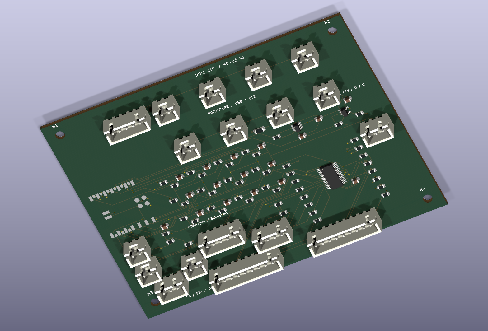

# NC-03 USB/BLE controller — KiCad A0

XIAO nRF52840 **Plus / non-Sense**を使う、NC-03用キャリア基板の試作設計です。**基板データは作成済み、実装・通信ファームウェア・実機互換性・ケース内取付は未検証**です。Switch/PSで動作する完成済みコントローラーではありません。

[KiCadプロジェクト](NC03_Controller.kicad_pro) / [回路図PDF](docs/schematic.pdf) / [基板表面](docs/board-top.svg) / [基板裏面](docs/board-bottom.svg) / [実装図](docs/assembly.svg) / [部品表CSV](BOM.csv) / [ピン割当](firmware/pinmap.csv) / [一次資料](docs/REFERENCES.md)

KiCadからの実データ描画。U1のXIAO本体は3Dモデル未収録のため描画されません。U1の29パッドと実装位置は基板図で確認できます。形状・配線の画像であり、通電写真ではありません。

## 現行天板のシリアルLED

新しい[四角窓・シリアルLED天板](../../print/h3c/PANEL_MULTICOLOR.md)では、16個のNeoPixel/WS2812互換モジュールと前面・側面ストリップをJ14から1本の直列チェーンで制御します。基板の配線変更は不要です。全ピクセルを含めてRGB電流予算150mAを分配します。A0のPCA9685・R41〜R56・J12/J13は旧単色構成用のオプションとなり、新LEDのDINには接続しません。

下表・回路図・基板BOMは旧単色ドライバーも搭載できるA0の共通回路を示します。現行天板でその部品は省略可能です。通信・LEDファームと新モジュール装着は未検証です。

## 構成

| 機能 | 回路・状態 |
|---|---|
| MCU | XIAO nRF52840 Plus、標準版/Senseは代用不可。Plus底面パッドも接合 |
| 主入力 | レバー4方向＋主6＋1P/STARTの12点をGPIO直結、330Ω＋1nF、外部10kプルアップ |
| 操作表示 | 既存の3mm単色LED16個、PCA9685PWで個別PWM、1kΩ抵抗で約2〜3mA/点 |
| 前面・左右RGB | 5VのWS2812系ストリップ用出力、3.3→5Vレベル変換、ストリップを直列に接続 |
| LED電源 | USB VBUS→350mA PTC→TPS22918。起動時OFF、USB設定完了後に予算内で有効化 |
| バッテリー | 保護回路付き1S LiPo、XIAO内蔵充電回路を利用。逆接保護・独立電源パスはキャリアに追加していない |
| モード | 外付けSPDT ON–OFF–ONでPC／PS外部変換器／Switch、別SPSTでUSB／BLE |
| USB | XIAOのType-Cを利用。キャリアに2個目のUSB端子やUSB信号配線は設けない |
| 拡張 | SWD、3.3V I²C。Home/Share/Touchpad等の補助入力基板は未設計 |
| 基板 | 110×85mm、2層、1.6mm想定、M3用φ3.2 NPTH×4、ピッチ100×75mm |

## 接続先と切り替え

| 選択 | 接続計画 | 実装状況 |
|---|---|---|
| PC＋USB | USB HIDゲームパッド、1msポーリング目標 | ハード回路のみ。ファーム未実装、遅延未測定 |
| PC＋BLE | HID over GATT、接続間隔7.5msを要求 | 同上。ホストによって実際の間隔が変わる |
| Switch＋USB | 初代Switch向けUSBプロトコル | ファーム未実装、実機未検証。Switch 2を含まない |
| PS＋USB | 対応する市販認証変換器へUSB接続 | 変換器・PS世代・USBプロファイルは選定/実機照合待ち。直結対応ではない |
| Switch/PS＋BLE | 対象外 | BLE搭載だけでは両コンソールの無線仕様に対応しない |

J10は**PC–PS/ADAPTER–SWITCH**の並びになる3位置スイッチです。共通GND、両端の信号を別々に読むので、中立OFF位置でも電源は落ちません。未接続はPS/ADAPTER位置になります。USB/BLEは別スイッチに分け、J11開放=USB、短絡=BLE。切り替え後は全入力解除→通信停止→USB再列挙またはBLE接続を行うファーム仕様です。[詳細](firmware/PROTOCOL.md)

PS4/PS5は認証のある対応変換器などが必要です。例としてBrookの公開資料を参照していますが、この自作デバイスは互換リストに載っておらず、変換器経由の動作も確認していません。USBの識別子だけでPS対応とはしません。PS世代の回答後に対象変換器を確定します。

## コネクター

全コネクターは上面実装のJST XH縦型2.50mm。**ピン番号は基板図の四角パッドを1番**として読む。一般的なLiPoのJST PHとは異なり、極性も共通規格と仮定しないこと。

| 端子 | ピン順 |
|---|---|
| J1 レバー | 1 GND、2 UP、3 DOWN、4 LEFT、5 RIGHT |
| J2〜J7 主ボタン | B1〜B6、各1 GND／2入力 |
| J8・J9 補助ボタン | 1P／START、各1 GND／2入力 |
| J10 プロファイル | 1 PC側、2共通GND、3 Switch側。SPDT ON–OFF–ON |
| J11 USB/BLE | 1選択入力、2 GND。開放USB、短絡BLE |
| J12 方向LED | 1 +5V_LED、2〜9はK0〜K7、共通アノード配線。方向は前面から0=右、以降反時計回り45°刻み |
| J13 ボタンLED | 1 +5V_LED、2〜9はK8〜K15、B1〜B6・1P・STARTの順 |
| J14 RGB | 1 +5V_LED、2 DIN、3 GND。ストリップの入力側へ |
| J15 電池 | 1保護済み電池＋、2電池−/GND。1S 3.7V公称／満充電4.2Vのみ |
| J16 電池スイッチ | 1電池＋、2 XIAO BAT＋。外付けSPSTで結ぶ。OFFでは電池を充電回路からも切り離す |
| J17 AUX | 1 3.3V、2 SDA、3 SCL、4 GND。5V機器用ではない |
| J18 SWD | 1 3.3V参照、2 SWDIO、3 SWDCLK、4 RESET、5 GND |

LS-55-01のハーネスの実際の方向・共通線は現物照合し、線色で決めない。GPIOへ5VやLED電源を接続しない。XIAO標準11 GPIOのキャリアとしては動作しない。

## 電源とケースへの組付け

USBと電池はXIAOの既存回路へ接続します。別の5V電源をJ14やVBUSへ注入しません。主電源はXIAO、キャリアの3.3Vは出力から受けるだけです。電池の保護回路・適切な充電設定は別途必要。J16をOFFにすると電池充電も止まります。

RGBの合計はソフトで150mAを初期上限にし、単色LED約50mA、MCU/無線、電池充電の最大電流を加えて実際に許可されたUSB電流を下回る必要があります。350mA PTCは精密な定電流制限ではありません。TPS22918の立ち上がりと47uFの充電突入は実測します。PCA9685の出力はリセット時LOWのため、全消灯を書いてからLED_ENABLEを上げます。電池駆動時は5V昇圧がないためLEDを消灯します。

USB Type-Cを外側に出す場合は、XIAOのUSB-Cにつながるデータ対応パネル延長部品をケースに固定します。**既存の背面8×6mm切り欠きはケーブル用であり、Type-Cメス端子のパネル固定穴ではありません。** 端子外形、CC/USB2.0配線とケーブル方向を現物照合したうえで、後から別ブラケット・開口を設計します。この変更で印刷中の下ケース/STL/3MFは変更していません。

基板のM3穴ピッチ100×75mmは独立した新設穴で、現行ケースのボスと一致しません。**ケースとの機械的適合は未完了**です。発注前に1:1基板図を印刷し、レバー本体・ボタン端子・ナット・USB S字ガイド・LED溝を避けて仮置きします。M3絶縁スペーサー等の取付台とType-C固定は次の機械設計。アンテナ側はcarrier銅箔禁止領域を確保しましたが、筐体内の金属レバー・配線・電池からの離隔とRF性能は実物評価が必要です。

## 検証と再生成

KiCad 10.0.8でERC、DRC、回路図とPCBのネット/フットプリント照合を実施。結果は[ERC](checks/ERC.rpt)／[DRC](checks/DRC.rpt)。配線済みデータが正本です。自動配線後に0.2mm未満のネック部分を0.2mmへ拡幅し、改めてDRCしています。

再生成は現在の基板配線を上書きします。通常の閲覧・編集は `NC03_Controller.kicad_pro` を開きます。生成スクリプトと詳細手順は[scripts/README.md](scripts/README.md)。

製造用Gerber/ドリルは含めていません。通信ファーム、PS変換器、ケース取付、充電電流・ESD・RF・遅延を確認してから製造リリースに進みます。ERC/DRC合格は、これらの実機検証の代わりにはなりません。

## 追加購入部品

[電子部品BOM](BOM.csv)は基板上89部品。ほかにXHハウジング/コンタクトとハーネス、外付けSPDT ON–OFF–ON×1、SPST×2（USB/BLEと電池）、データ対応USB-Cパネル延長、適切な保護付き1S電池、RGBストリップ、現行天板用の9.1mm角シリアルRGBモジュール16個（旧丸窓天板のみ3mm単色LED）、M3取付部品が必要です。XIAO本体はU1としてBOMに含みます。ストリップ長、電池サイズ、PS変換器は未確定です。

ソフトウェアはMIT。Seeedのランドパターンを組み込むPCB/回路図と派生出力はCC BY-SA 4.0。[出典・変更点・例外](vendor/README.md)。筐体・デカールのCC BY 4.0とNULL FONTのOFLは変更していません。
