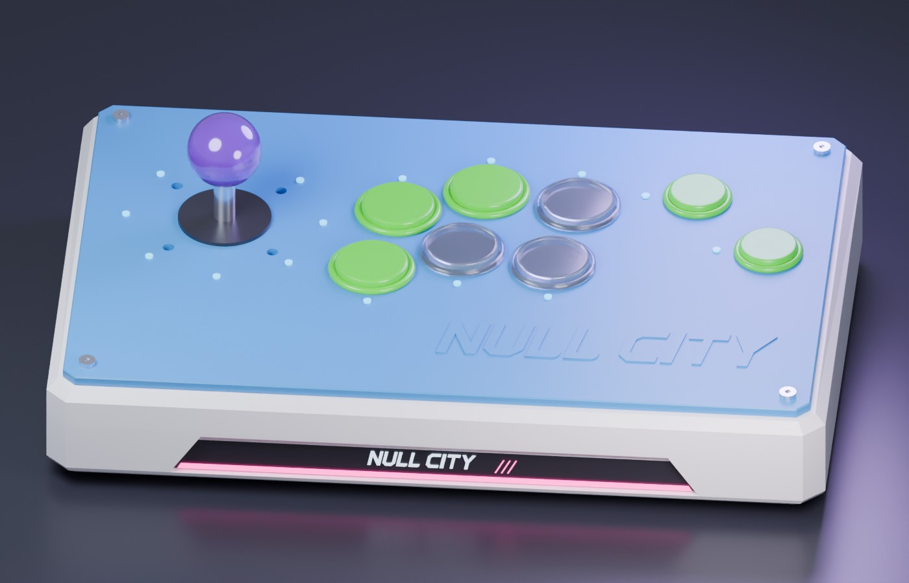

# NULL FONT エンボス天板



[H3C用3MF](03_control_panel_embossed.3mf) ／ [STL](PRINT_03_control_panel_embossed.stl) ／ [Blender組立モデル](NC03_embossed.blend)

現在の平らな天板から派生させた任意の版。印刷済みの天板や標準STL・3MFは置き換えていない。

| 項目 | 仕様 |
|---|---|
| 文字 | NULL CITY |
| 書体 | [NULL FONT Italic TTF](../../fonts/null-font/NULLFont-Italic.ttf)をBlenderでメッシュへ変換 |
| 位置 | 前側の空き部分。レイアウト原点から中心X=63、Y=−52.9 mm |
| 大きさ | 幅130 mm、文字高約19.9 mm |
| 浮き出し | 天板上面から0.6 mm。文字の根元は天板へ結合 |
| 天板 | 最大288 × 178 mm、基板厚4 mm、文字部分の全厚4.6 mm。外周上下C0.5 |
| 取付穴 | 元の天板と同じ。レバー40 × 40 mm、全33貫通穴 |
| 印刷 | H3C 0.4 mm、PLA、0.28 mm積層、壁3周、上下面3層、Gyroid5%、サポートなし |
| CLI見積 | 2時間57分52秒 / 104.25 g。実機の準備や補正により3時間を超える場合あり |

3MFは単一材料。ロゴも天板と同色で、色替えは設定していない。画像は単色の青いPLAを想定したレンダリング。発光や操作部は外観モデルで、ロゴ版の実機印刷・嵌合は未実施。

既存の平面デカールは凹凸への貼付を検証していない。エンボスを使う場合は、まずデカールなしで使用する。

## 再生成

リポジトリ直下から、最新の平面版 `NULL_CITY_NC03.blend` を入力として実行する。

```sh
/Applications/Blender.app/Contents/MacOS/Blender --background NULL_CITY_NC03.blend --python-exit-code 1 --python scripts/build_embossed_panel.py
python3 print/embossed/slice.py
```

Blender 5.3.0で水密・33貫通穴・上面から0.6 mmの高さを確認。Bambu CLI終了コード0、造形範囲内、サポート不使用、3MF ZIP整合性を確認した。
