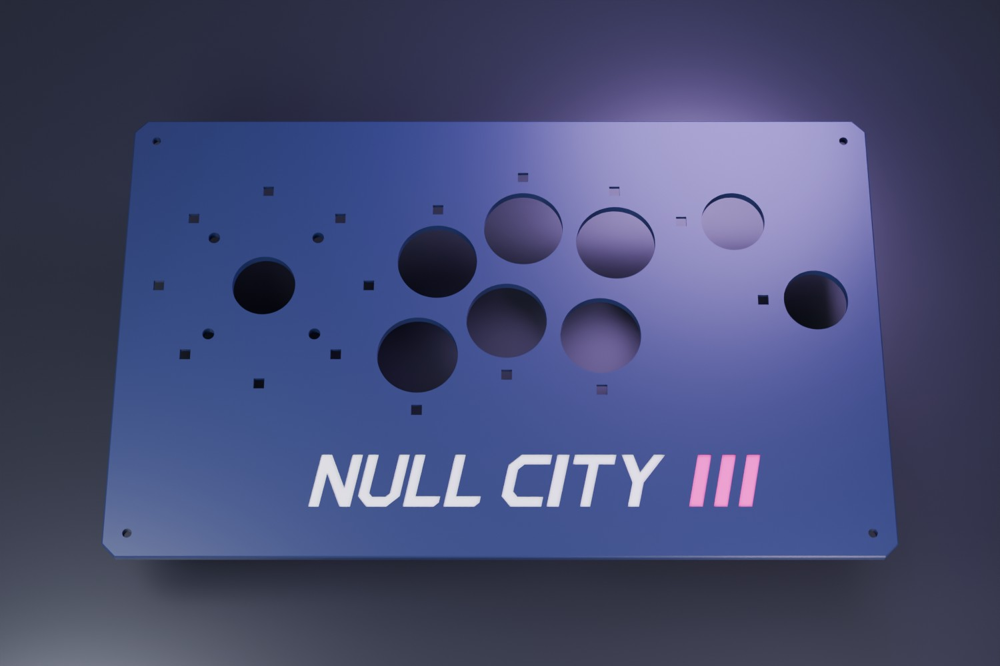
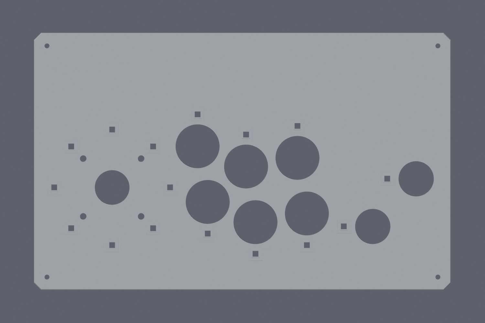

# 天板：四角LED窓・凹ロゴ・表面だけのマルチカラー

[スライス済み3MF](03_control_panel_multicolor_sliced.3mf)をBambu Studioで**プロジェクトとして**開きます。[未スライスのプロジェクト](03_control_panel_multicolor.3mf)も付属。H3C / 0.4mm / Textured PEI / PLA用です。新天板の印刷は開始していません。

## 1枚として印刷する

天板は完成時に**1枚の一体造形**です。NULL FONTのNULL CITYを深さ0.6mmの凹文字にし、その底面に白、`///`の底面にマゼンタを印刷します。別のロゴ部品を接着・はめ込みする方式ではありません。

スライサー内部では色の領域を表す3つのボリュームを**1オブジェクト内**に格納しています。これらを別プレートに分けたり、自動接地したりしないでください。STLを個別に開くと位置関係や色が失われるため、上記3MFを使います。

| 領域 | 論理フィラメント | 実機の割当例 |
|---|---|---|
| 天板本体 | 1 青PLA | スロット1 |
| NULL CITYの凹部底面 | 2 白PLA | スロット5 |
| ///の凹部底面 | 3 マゼンタ／ピンクPLA | スロット2 |

スロットは保存された固定割当ではありません。送信画面で実際の装填材へ対応づけます。すべて同系統のPLAを使用し、PLA/PETG/TPUを同一ロゴに混ぜません。表面だけ多色にし、裏側・本体内部を白やマゼンタで埋め尽くす設定にはしていません。

## 保存設定と見積

- 積層0.20mm、壁3周、上下面3層、Gyroid 5%、外周ブリム5mm、サポートなし。
- ロゴ底面の色厚は0.60mm。色を使うのは**20層のうち15〜17層目**のみ（スライス内部のゼロ基準では14〜16）。それ以外は本体の青だけ。
- 凹部底面Z=3.4mm、周囲天面Z=4.0mm。白・マゼンタはZ=2.8〜3.4mmにあり、3層分の厚さと下地への接合面を確保。
- プライムタワーON、幅30mm。これは色切替時の印刷補助であり、製品に組み付けるパーツではありません。
- CLI見積は**3時間00分03秒・90.06g**。実機の材質プロファイル、割当・補正・タワー位置で変わり、3時間未満を保証しません。

単色版の `03_control_panel.3mf` / `03_control_panel_fast.3mf` と `STL/PRINT_03_control_panel.stl` にも同じ四角穴と凹ロゴを反映していますが、色分け情報はこの専用3MFだけです。6プレート版も形状は更新していますが、天板は単色扱いです。マルチカラー天板の造形では専用3MFを選びます。

## 四角窓と裏側のシリアルLED

16窓は**4×4mmの正方形**。裏側には9.5×9.5mm・深さ0.6mmのPCB受け座と、5.6×5.6mm・深さ2.2mmの発光パッケージ逃げを設けています。[Adafruit NeoPixel Mini PCB #1612](https://www.adafruit.com/product/1612)の公表外形9.1×9.1×3.2mmを基準とします。WS2812互換信号でも基板外形は共通ではなく、別サイズの市販基板がそのまま付くとは限りません。

基板を裏側から当て、受け座で位置決めし、裏側の絶縁保持テープで取り外し可能に固定します。スナップ爪や未選定のねじは追加していません。LED・PCBの実際の厚さ、配線の出口、保持方法、光漏れは小型試作と現物で確認が必要です。モジュール自体ははんだ付け済み製品を使用し、裸のWS2812チップを樹脂に直接付けません。

方向窓は半径40mm、主ボタンの表示窓はボタン中心から22mmへ移動しました。9.5mm受け座から主ボタン／取付穴までの保守的な壁厚は最小2.05mmです。レバーの外側ハウジング・端子、ボタン締付リングとLED基板・配線の実物干渉は未確認。以前の丸LED穴の取付試験が、この新LED構成の試験済みを意味するものではありません。

配線は **制御基板J14 DIN → 方向8個 → B1〜B6 → 1P → START → 前面・左右のストリップ** の直列チェーン。各モジュールのDIN/DOUTを区別し、5V/GNDは共通化します。A0基板J12/J13の単色LED用出力は、この新しいシリアルLEDには接続しません。

RGBの合計電流は16個分も含めてソフトで制限します。コントローラーの初期RGB予算150mAはチェーン**全体**に対する値です。16個＋ストリップの全白・最大輝度は想定せず、MCUと充電の電流も含めてUSB予算を確認します。電池でのLED点灯はA0では未対応です。

## データの検証

Blenderで20個の印刷部品の水密、33個の貫通穴、四角窓の角の貫通、窓直外の天面、裏側2段の深さを確認。専用3MFは1オブジェクト・3色、共通原点、青以外を使う層範囲、3色すべての実使用、サポートなし・範囲内を確認しています。[機械可読結果](panel_multicolor_validation.json)。実機での3色印刷・新LEDの装着は未実施です。

再生成はBlender本体スクリプト実行後、`python3 print/h3c/build_multicolor_panel.py`、`python3 scripts/validate_panel_multicolor.py`。ロゴは文字アウトラインから生成し、全面デカールの模様をそのまま多色化したものではありません。デカールは別の装飾方法として残しています。凹ロゴを見せる場合は、その上から全面デカールを貼りません。
