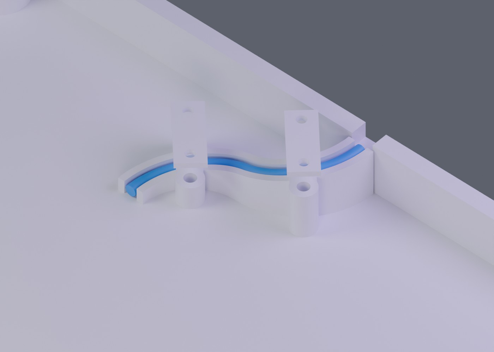

# USBケーブルのS字ガイド（外径4 mm想定）



背面出口の内側に一体ガイドを設け、2個の押さえでケーブルの浮きを抑える試作機構。画像の青いケーブルは説明用で、印刷部品には含まない。押さえは形を見せるため8 mm上へ離して表示している。

## 先に確認する小型試験片

[ガイド試験片＋押さえ2個のH3C用3MF](USB_S_guide_fit.3mf) ／ [ガイド試験片STL](FIT_USB_S_guide.stl)

CLI見積 **52分46秒・25.12 g**。下ケースの約80 × 63 mmの領域を切り出し、背面出口・立ち上がり・溝・インサート穴を再現した。PLA、積層0.28 mm・壁3周・上下面3層・Gyroid5%、サポートなし。下ケース全体を印刷する前に、使うケーブルと締結部品で嵌合・保持を確認する。

| 項目 | 仮の設計値 |
|---|---|
| ケーブル外径 | 4.0 mm。一般のUSBケーブルに共通の規格値ではない |
| 溝幅 | 4.8 mm |
| 経路 | 2つの90°円弧による緩いS字。平面の中心線半径24 mm |
| 高さ | 中心線が背面Z20から内部Z7.4へ滑らかに下降。既存8 × 6 mm出口に接続 |
| 曲げ | 3D経路の数値サンプルで最小半径約23.21 mm。使用ケーブルの指定を優先 |
| 押さえ | 同形2個、26 × 10 × 2 mm、M3穴ピッチ18 mm、穴径3.4 mm。平らに印刷可能 |
| 固定 | M3熱圧入インサート長さ3 mmを4個、M3×6ねじ4本、ワッシャー約0.5 mmを4枚 |
| インサート下穴 | φ4.1 × 深さ4.5 mm。選んだ製品の推奨寸法と試験片で照合 |

ケース四隅用の長さ6 mmインサートとは別部品。[BOM F10〜F12](../../BOM.md)を参照。

ケーブルの許容曲げ半径は製品ごとに異なる。[igusの説明](https://www.igus.com/cables/unharnessed-cables-bending-radius)では外径の倍率で指定され、[L-comのUSBケーブル図面例](https://www.l-com.com/Images/Downloadables/2D/CBL-USB2-2828-1000_2D.pdf)には10倍という指定もある。この試作の半径をすべてのUSBケーブルに適用できるという意味ではない。硬い・太いケーブルや、指定半径がこれを上回るケーブルは[寸法JSON](../../artwork/usb_relief.json)を調整して再生成する。

## 組み立て

1. 試験片のインサート穴に長さ3 mmのM3インサートを4個取り付ける。溶かし過ぎ・割れ・傾きがないか確認する。
2. コネクタを穴へ通す必要はない。上ケースと押さえを外した状態で、ケーブルを背面の切り欠きと開いた溝へ横から敷く。
3. 基板側に余長を残し、押さえ2個をM3×6ねじとワッシャーで固定する。ケーブルを潰すまで締めない。
4. 外側を軽く引き、ケーブルの移動、被覆の傷、押さえの浮き、基板側の余長への引張りを確認する。保持力はまだ実測していない。保持できない場合は寸法や経路を見直す。
5. 下ケース全体で、レバー・ボタン・端子・基板・配線との干渉も確認する。ケーブルガイドはUSBコネクタ自体の固定部品ではない。

押さえは脱落防止とS字経路の維持用。実ケーブルの曲げ・保持・反復引張試験は未実施で、引張保持力の定量値は未測定。

## 本体用データ

[下ケース＋押さえの単独3MF](../h3c/01_lower_tray.3mf) ／ [下ケースSTL](../../STL/PRINT_01_lower_tray.stl) ／ [押さえ1](../../STL/PRINT_USB_bridge_1.stl) ／ [押さえ2](../../STL/PRINT_USB_bridge_2.stl)

6プレート版では押さえ2個を**プレート1**へ同載。外観キャップのプレート4を省略しても押さえを省かずに印刷できる。天板・穴位置・ケース外形は維持している。

## 再生成と検証

```sh
/Applications/Blender.app/Contents/MacOS/Blender --background --factory-startup --python-exit-code 1 --python NULL_CITY_NC03.py
/Applications/Blender.app/Contents/MacOS/Blender --background NULL_CITY_NC03.blend --python-exit-code 1 --python scripts/validate_usb_relief.py
/Applications/Blender.app/Contents/MacOS/Blender --background NULL_CITY_NC03.blend --python-exit-code 1 --python scripts/render_usb_relief.py
python3 print/usb-relief/slice_fit.py
python3 print/h3c/slice_plates.py
python3 print/h3c/combine_plates.py
```

Blender 5.3で下ケース・押さえの水密、想定ケーブルと溝／押さえの非干渉、保守的なレバー・ボタン外形と押さえ／下ケースの非干渉を確認。実際の配線端子・ハーネス・制御基板とねじ頭の完全な包絡は未確定で、ケース全体の仮組みはIssue #5で継続する。スライス済みデータはBambu CLI終了0、造形範囲内・サポート不使用、ZIP整合性を確認済み。
